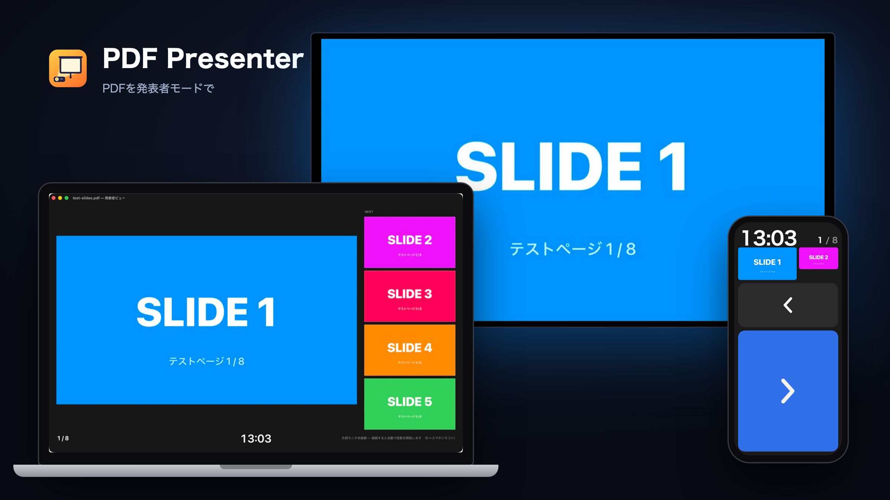

# PDF Presenter



PDFを PowerPoint のプレゼンモードと同じ体験で発表する macOS 専用アプリ。

- **外部モニタ／プロジェクタ** … 現在のスライドを全画面表示（黒背景・レターボックス）
- **MacBook内蔵画面** … 発表者ビュー（現在スライド ＋ 次の4枚 ＋ ページ番号）

## ダウンロード

[Releases](https://github.com/koenma777/pdf-presenter-mac/releases/latest) から `PDFPresenter-<バージョン>.zip` をダウンロードする。
macOS 14 以降、Apple シリコンと Intel の両方で動く（Intel の実機では未確認）。

zip を開くと、アプリと手順書（`はじめにお読みください.html`）が入っている。
Apple の公証（notarization）を通していないので、**最初の1回だけ** macOS に止められる。開き方は手順書に書いてある。

## ソースからビルドする

Xcode のコマンドラインツール（Swift 5.9 以降）が要る。

```bash
git clone https://github.com/koenma777/pdf-presenter-mac.git
cd pdf-presenter-mac
./make-app.sh          # → ~/Applications/PDFPresenter.app
```

- アプリのアイコンは `Resources/AppIcon.png`（1024×1024）から、macOS標準の `sips` と `iconutil` で自動的に作られる
- 出力先は `PDFPRESENTER_APP_PATH` で変えられる（例：`PDFPRESENTER_APP_PATH=/tmp/test/PDFPresenter.app ./make-app.sh`）。
  普段使っているアプリに触らずに試しに作るとき用。出力先は作り直すので `.app` で終わるパスだけを受け付ける
- `PDFPRESENTER_UNIVERSAL=1` を付けると、Apple シリコンと Intel の両方で動く版（arm64＋x86_64 を `lipo` でまとめたもの）を作る。
  バージョン番号は `make-app.sh` 冒頭の `APP_VERSION` の1か所で決める

### 配布用の zip

```bash
./make-dist.sh         # → output/dist/PDFPresenter-<バージョン>.zip
```

- ユニバーサル版のアプリと、受け取る人向けの手順書（`はじめにお読みください.html`）を1つの zip にする。
  アプリは一時フォルダに作るので `~/Applications` には触らない
- 手順書の元データは `docs/guide/guide.html` と `docs/guide/images/`。画像は zip を作るときに HTML へ埋め込まれ、1ファイルで開ける
- 作った zip は展開し直して、署名・対応する種類・バージョン・手順書を確かめてから、場所・大きさ・SHA-256 を表示する
- 正式な署名（Developer ID）は無いので、受け取った人は最初の1回だけ macOS の警告を越える操作が要る（手順書に書いてある）

## 使い方

1. `PDFPresenter.app` を起動 → ファイル選択ダイアログでPDFを選ぶ
   - PDFを `.app` にドラッグ&ドロップ、または右クリック →「このアプリケーションで開く」でもOK
2. 外部モニタを繋ぐと自動で投影が始まる（起動後に繋いでも、抜いても自動追従）

### キー操作

| キー | 動作 |
|---|---|
| `→` `↓` `Space` `PageDown` / クリック | 次へ |
| `←` `↑` `PageUp` | 前へ |
| `Home` / `End` | 最初 / 最後 |
| `S` | 発表者ビューと投影の画面を入れ替え |
| `R` | スマホリモコンのQRを表示／非表示 |
| `Esc` / `⌘Q` | 終了（QR表示中の `Esc` はQRを閉じるだけ） |
| `⌘O` | 別のPDFを開く |

プレゼンリモコン（ページ送り器）は PageUp/PageDown を送る規格なので、そのまま使える。

### スマホリモコン

1. 発表者ビューで `R` を押すとQRが出る（投影側には出ない）
2. スマホのカメラで読み取って開く → 「次へ／戻る」とページ番号が使える。開いた時点でQRは自動で閉じる
   - スマホには時計（スマホ自身の時刻）と、今と次のスライドの縮小画像も出る。発表者ビューの下部中央にも時計が出る
   - スマホの「今のスライド」の画像に指を置いて動かすと、同じ位置に赤い点（レーザーポインター）が投影と発表者ビューに出る。指を離すと消える
   - スマホにアプリは不要。**Macと同じWi-Fi**につないでおく
   - 会場Wi-Fiが端末間の通信を遮断している場合は、スマホのテザリングにMacをつなぐ
   - iPhone のテザリング＋IPv6専用の回線（au系など）でも使える。その場合 QR の URL は `http://[240b:…]:8765/…` のような IPv6 になる
   - QRが読めないときは、QRの下のURLをスマホのブラウザに手入力する
3. Wi-Fiを切り替えたら `R` を押し直す（QRのURLが新しいIPアドレスで作り直される）

手元の macOS 26 では、ローカルネットワークの許可ダイアログは出ずにそのままスマホからつながった。もし macOS から許可を求められたら「許可」を選ぶ。

## 設計メモ

- **PDFKit + AppKit のみ**。外部依存ゼロ（客先で環境要因の事故を起こさないため）
- 投影ウィンドウは `toggleFullScreen` ではなく **ボーダーレスウィンドウを画面全面に配置**する。
  ネイティブ全画面は Space の切り替えが挟まるため、プレゼン中の挙動が読みにくい。
- ページ画像は接続中の全ディスプレイの実ピクセル数を基準に焼き、前2ページ・後5ページを先読みする
  （`PDFRenderer`）。ページ送りで待たされない。
- `PDFPage.bounds(for:)` は**回転前**の寸法を返すが `draw(with:to:)` は回転を適用して描く。
  90/270度回転ページでは縦横を入れ替えたキャンバスを用意しないと見切れる（対応済み）。

- スマホリモコンは **Network.framework（HTTPを最小限に自前処理）と CoreImage（QR生成）だけ**で作り、
  外部依存ゼロを維持している。リモコン画面のHTMLもバイナリに文字列で内蔵（外部リソースなし、会場にネットが無くても動く）
- `R` を押すまでポートを開かない（一度開いたらアプリ終了まで。8765番が使用中なら空きポート）。
  URLには起動ごとに作る合言葉（英小文字＋数字16文字）が入り、合言葉が違うリクエストはすべて 404。
  ページを動かす操作は POST だけ受け付ける（リンクのプレビュー取得や先読みで勝手に進まないように）
- 待ち受けは IPv4 と IPv6 の両方（同じポート番号のデュアルスタック1つ）。IPv6専用のテザリングでは、Macの IPv4 が
  CLAT の仮アドレス（192.0.0.0/29、ほかの機器から届かない）しか無いため。QR に載せるのは使える IPv4（en0 優先）、
  無ければ IPv6 のグローバル、それも無ければ ULA（リンクローカルは使わない）。
  他のプロセスが IPv4 だけ・IPv6 だけ・両方のどれでポートを使っていても bind が失敗するので、取り合いは見逃さない
- 接続元は同じネットワークの機器に限る。受け付けるのは、ループバック（127.0.0.0/8・::1）、リンクローカル（169.254.0.0/16・fe80::/10）、
  IPv4 のプライベート範囲（10/8・172.16/12・192.168/16）とキャリアNAT（100.64.0.0/10）、IPv6 の ULA（fc00::/7）、
  それとこのMacのいずれかのインターフェースと同じネットワーク（ネットマスク・プレフィックス長の範囲）。それ以外は応答せずに閉じる。
  IPv6専用の回線では Mac のグローバル IPv6 がインターネット側から見える場合があり、自前のHTTP処理を外にさらさないため。
  プライベートIPv4 を範囲ごと許すのは、会場によってスマホとMacが別のサブネットにいて経路でつながっている構成を壊さないため
  （プライベートIPv4 はインターネット側から届かないので露出は増えない）
- 縮小画像は `GET /r/<合言葉>/slide/<n>` で返す長辺640px程度のJPEG。描画は全画面用と同じ直列キューで行うが、
  キャッシュは全画面用（投影用の画像）とは別に持ち、ページ送りの先読みを追い出さない。
  state の `doc` はPDFを開くたびに変わる番号で、`⌘O` で別のPDFに替えたときスマホが古いPDFの画像を捨てる合図になる
- ポインターの点はスライドの描画に混ぜず、軽いサブビューとして上に重ねて動かすだけにしている（4K相当の画像を毎回描き直さない）。
  最後の更新から1.5秒で自動的に消える（スマホからの「消す」が届かなかったとき・スマホがスリープしたときの保険）。
  スマホ側は同時に飛ばす要求を1本・毎秒40回までに間引き、指が止まっていても0.5秒ごとに位置を送り直す
- 開発用：`PDFPresenter --remote <pdf>` で起動すると最初からQRを出し、標準出力に `Remote URL: …` を出す

## 今回入れていない機能

タイマー / スライド一覧グリッド / 発表者ノート / 描画（レーザーポインタはスマホリモコンから使える）。
状態は `PresentationController` に集約してあるので後から足しやすい。

## ライセンス

[MIT License](LICENSE)
